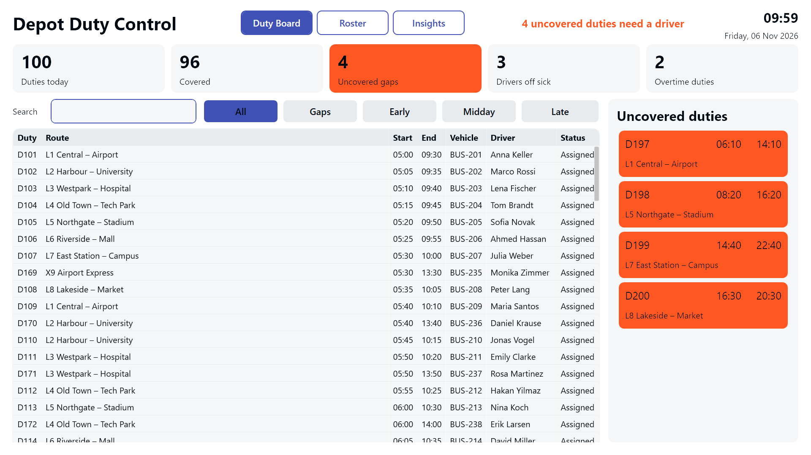
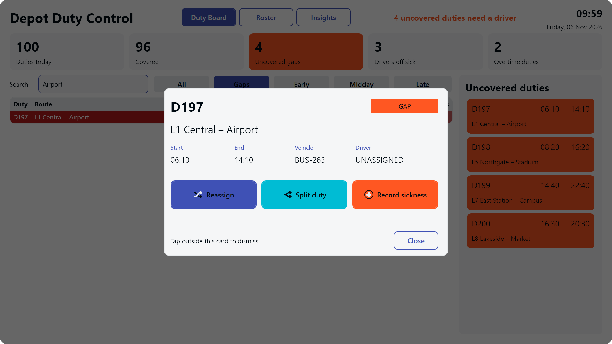
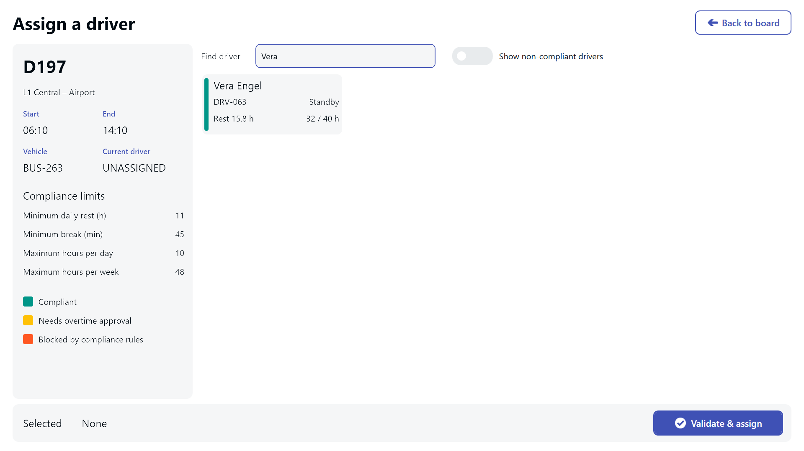

---
layout: post
title: Dienstzuteilungs-Board für den Busbetriebshof - Jede Linie besetzt, auch wenn sich der Plan ändert
date: 2026-11-06 00:00:00 +0000
tags: transportation
image: /assets/2026-11-06-09-58-06/title.jpg
bg_alternative: true
description: "Ein Touchscreen-Board für die Schichtleitung im Busbetriebshof, das unbesetzte Dienste sofort sichtbar macht und dabei hilft, Dienste neu zuzuweisen, zu teilen und abzudecken, ohne Ruhezeitregeln zu verletzen."
prompt: |
  Entwirf eine Anwendung für einen Busbetriebshof, mit der Fahrer den Diensten zugeteilt werden. Zeige jeden Dienst mit Linie, Beginn und Ende, Fahrzeug und zugewiesenem Fahrer an. Die Schichtleitung soll einen Dienst öffnen können, um ihn neu zuzuweisen, zu teilen oder eine Krankmeldung zu erfassen, wobei entstehende Lücken automatisch hervorgehoben werden. Integriere einen Dialog zur Ruhezeitprüfung, der unzulässige Zuweisungen blockiert, sowie einen Dialog zur Genehmigung von Überstunden. Stelle Beispieldaten für einhundert Dienste und achtzig Fahrer bereit.
downloads:
  - name: Peakboard.pbmx
    url: /assets/2026-11-06-09-58-06/Peakboard_de.pbmx
lang: de
permalink: /de/bus-depot-duty-allocation-board-keeping-every-route-covered-when-the-plan-changes/
translation_url: /en/bus-depot-duty-allocation-board-keeping-every-route-covered-when-the-plan-changes/
---


Jeden Morgen muss ein Busbetriebshof seinen kompletten Fahrplan auf die Straße bringen, und nur selten übersteht der Plan die ersten Stunden des Tages unverändert. Um 05:20 Uhr meldet sich ein Fahrer krank, eine verspätete Schicht verkürzt die Ruhezeit eines Kollegen, oder für eine Linie steht nur noch jemand zur Verfügung, der seine Wochenarbeitszeit schon fast ausgeschöpft hat. In diesem Artikel stellen wir ein Dienstzuteilungs-Board vor, mit dem die Schichtleitung im Betriebshof solche Probleme an einer zentralen Stelle erkennt und löst, bevor ein Bus ohne Fahrer dasteht.

## Das Problem: ein Plan, der sich minütlich ändert

Viele Betriebshöfe bewältigen die täglichen Änderungen noch immer mit Tabellen, Dienstplänen auf Papier und Telefonaten. Das funktioniert, bis mehrere Dinge gleichzeitig schiefgehen. Dann kann ein unbesetzter Dienst zwischen zwei Blättern Papier untergehen, und unter Zeitdruck ist schnell ein Fahrer eingeteilt, der noch nicht ausreichend geruht hat.

Die Folgen gehen über den reinen Mehraufwand hinaus. Ein nicht besetzter Dienst bedeutet für die Fahrgäste eine ausgefallene Fahrt, und eine regelwidrige Zuweisung ist für das Verkehrsunternehmen ein Sicherheits- und Compliance-Problem. Die Schichtleitung muss den aktuellen Stand des Tages auf einen Blick erfassen können, und die Regeln müssen während der Arbeit automatisch geprüft werden.

## Ein Board für den gesamten Betriebstag

Die Anwendung ist für einen großen Touchscreen oder ein interaktives Terminal im Dispositionsbüro oder in der Leitstelle gedacht und kann dort den ganzen Betriebstag über im Einsatz bleiben.

Das Haupt-Board listet 100 Dienste mit Linie, Beginn und Ende, Fahrzeug, zugewiesenem Fahrer und Status auf. Übersichtskacheln zeigen **Dienste gesamt**, **besetzte Dienste**, **offene Lücken**, **krank gemeldete Fahrer** und **Überstundendienste**, sodass die Schichtleitung mit einem Blick weiß, wo der Tag gerade steht.

Unbesetzte Dienste sind bewusst kaum zu übersehen. Sie erscheinen an drei Stellen gleichzeitig:

- Als **rote Zeilen** in der Diensttabelle
- Als **orangefarbene Karten** in einem eigenen Seitenbereich
- In einem **Zähler und Banner** am oberen Bildschirmrand

## Einen Dienst mit wenigen Fingertipps bearbeiten

Typischerweise beginnt die Bedienung damit, dass die Schichtleitung auf einen Dienst tippt, entweder in der Tabelle oder direkt im Lückenbereich. Daraufhin bietet ein Dialog drei Aktionen an.

### Neu zuweisen

**Neu zuweisen** öffnet eine bildschirmfüllende Fahrerauswahl, die alle infrage kommenden Fahrer mit Ruhezeit, Wochenstunden und Compliance-Status anzeigt. Die Schichtleitung wählt einen Fahrer aus und lässt die Zuweisung prüfen. Dann gibt es drei mögliche Ergebnisse:

- Eine regelkonforme Zuweisung wird direkt übernommen.
- Eine regelwidrige Zuweisung wird von einem Dialog gestoppt, der darauf hinweist, dass die Regeln nicht übergangen werden können.
- Eine Zuweisung, die Überstunden erfordert, durchläuft einen Genehmigungsdialog, in dem die Schichtleitung eine Begründung und eine PIN eingibt.

Genau hier zeigt das Board seinen Wert. Selbst an einem hektischen Morgen und bei größter Müdigkeit kann niemand versehentlich einen Fahrer ohne ausreichende Ruhezeit auf die Strecke schicken, und jede Überstundenentscheidung ist mit einem Namen und einer Begründung verknüpft.

### Dienst teilen

Manchmal kann niemand einen Dienst vollständig übernehmen, aber zwei Fahrer können jeweils einen Teil davon abdecken. Bei **Dienst teilen** wird der Trennzeitpunkt mit einem Schieberegler festgelegt. Die Schichtleitung entscheidet, ob der aktuelle Fahrer den ersten oder den zweiten Teil behält. Der andere Teil wird zu einem unbesetzten Dienst und erscheint als neue Lücke.

### Krankmeldung erfassen

**Krankmeldung erfassen** nimmt den Grund, die voraussichtliche Abwesenheit, den Umfang und optional eine Notiz auf. Die betroffenen Dienste werden sofort freigegeben und als Lücken markiert. So wird aus einem Anruf um 05:20 Uhr unmittelbar eine klare Liste der Dienste, die neu besetzt werden müssen.

## Dienstplan und Auswertungen

Neben dem Tages-Board gibt es eine Dienstplanansicht, in der die Schichtleitung alle 80 Fahrer durchsuchen, die Dienste und Stunden einzelner Personen einsehen, Fahrer krank melden oder wieder in den Dienst zurückholen kann.

Die Auswertungsansicht unterstützt Planung und Nachvollziehbarkeit. Sie vereint Diagramme zur Arbeitsbelastung, anpassbare Compliance-Grenzwerte, ein Änderungsprotokoll und eine Übersicht der Überstundenentscheidungen. Wenn später jemand fragt, warum ein Dienst verschoben wurde oder wer zusätzliche Stunden genehmigt hat, liegt die Antwort bereits vor.

## Wer profitiert

- **Schichtleitung und Disposition** sehen jede Lücke sofort und können sie schließen, ohne mit Papier und Telefonlisten zu jonglieren.
- **Fahrer** sind vor Zuweisungen geschützt, die ihre Ruhezeit verkürzen würden, und ihre Arbeitsbelastung bleibt sichtbar.
- **Die Betriebshofleitung** erhält eine lückenlose Dokumentation aller Änderungen und Überstundengenehmigungen.
- **Fahrgäste** profitieren davon, dass weniger Fahrten ausfallen, weil eine Lücke niemandem rechtzeitig aufgefallen ist.

## Ergebnis

Das Dienstzuteilungs-Board ersetzt einen Morgen voller Papier, Tabellen und Telefonate durch eine klare Übersicht darüber, was besetzt ist und was nicht. Lücken fallen sofort auf, Compliance-Regeln werden direkt bei der Zuweisung durchgesetzt, und Überstundenentscheidungen werden nebenbei dokumentiert.

Die Beispieldaten funktionieren sofort, ganz ohne Hub oder externes System. Das Projekt eignet sich daher als realistische Demonstration oder als Ausgangspunkt für eine angebundene Dienstplanungslösung.