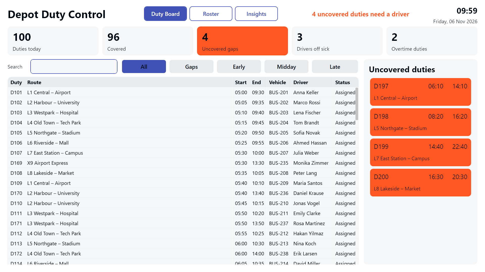
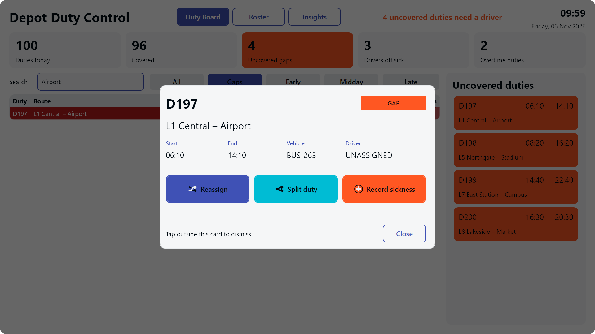
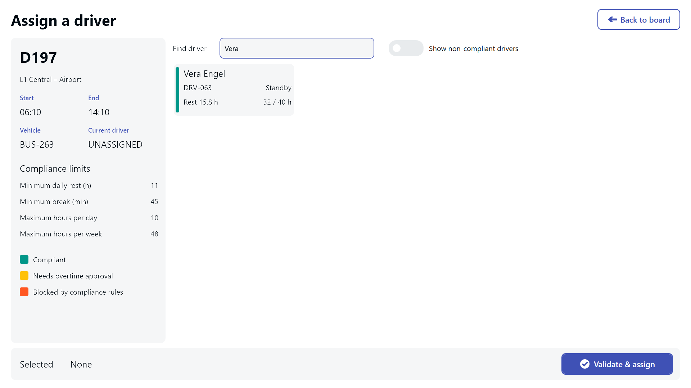

---
layout: post
title: Bus Depot Duty Allocation Board - Keeping Every Route Covered When the Plan Changes
date: 2026-11-06 00:00:00 +0000
tags: transportation
image: /assets/2026-11-06-09-58-06/title.jpg
bg_alternative: true
description: "A touch-screen board for bus depot supervisors that makes uncovered duties impossible to miss and helps them reassign, split, and cover work without breaking rest-time rules."
prompt: |
  Design an application for a bus depot that allocates drivers to duties. Show every duty with route, start and end times, vehicle and assigned driver, and let a supervisor open a duty to reassign it, split it, or record sickness with automatic gap highlighting. Include a rest-time validation dialog that blocks non-compliant assignments and an overtime approval dialog. Provide sample data for one hundred duties and eighty drivers.
downloads:
  - name: Peakboard.pbmx
    url: /assets/2026-11-06-09-58-06/Peakboard.pbmx
lang: en
permalink: /en/bus-depot-duty-allocation-board-keeping-every-route-covered-when-the-plan-changes/
translation_url: /de/bus-depot-duty-allocation-board-keeping-every-route-covered-when-the-plan-changes/
---


Every morning, a bus depot has to get its full timetable on the road, and the plan rarely survives first contact with the day. A driver calls in sick at 05:20, a late-running shift eats into someone's rest period, or a route needs cover from a driver who is already close to their weekly limit. In this article, we look at a duty allocation board that gives depot supervisors one place to spot these problems and solve them before a bus is left without a driver.

## The problem: a plan that changes by the minute

Many depots still handle daily changes with spreadsheets, paper rosters, and phone calls. That works until several things go wrong at once. An uncovered duty can get lost between two sheets of paper, and under time pressure it is easy to assign a driver who has not had enough rest.

The cost goes beyond the inconvenience. A missed duty means a cancelled service for passengers, and a non-compliant assignment is a safety and regulatory problem for the operator. Supervisors need to see the current state of the day at a glance, and they need the rules checked for them while they work.

## One board for the whole operating day

The application is designed for a large touch screen or interactive terminal in the dispatch office or the supervisor's control room, where it can stay in use throughout the operating day.

The main board lists 100 duties with their route, start and end times, vehicle, assigned driver, and status. Summary tiles show **total duties**, **covered duties**, **open gaps**, **drivers off sick**, and **overtime duties**, so the supervisor knows the state of the day as soon as they look up.

Uncovered duties are deliberately hard to miss. They appear in three places at once:

- As **red rows** in the duty table
- As **orange cards** in a dedicated side panel
- In a **counter and banner** at the top of the screen

## Handling a duty in a few taps

A typical interaction starts when a supervisor taps a duty, either in the table or directly in the gap panel. A dialog then offers three actions.

### Reassign

**Reassign** opens a full-screen driver picker that shows the candidates with their rest time, weekly hours, and compliance status. The supervisor selects a driver and validates the assignment, and one of three things happens:

- A compliant assignment goes through.
- A non-compliant assignment is stopped by a dialog stating that the rules cannot be overridden.
- An assignment that requires overtime goes through an approval dialog, where the supervisor enters a reason and a PIN.

This is where the board earns its place. Even on a hectic morning, a tired supervisor cannot accidentally put a driver on the road without enough rest, and every overtime decision has a name and a reason attached to it.

### Split duty

Sometimes nobody can cover a whole duty, but two drivers can each cover part of it. **Split duty** uses a slider to choose the cut time. The supervisor decides whether the current driver keeps the first or the second part, and the other part becomes an uncovered duty that shows up as a new gap.

### Record sickness

**Record sickness** captures the reason, the expected absence, the scope, and an optional note. The affected duties are released and flagged as gaps straight away, so that one phone call at 05:20 immediately becomes a clear list of work to cover.

## Roster and insights

Beyond the daily board, the roster screen lets supervisors search all 80 drivers, review an individual's duties and hours, report a driver sick, or return them to service.

The insights screen supports planning and accountability. It brings together workload charts, adjustable compliance limits, a change log, and a record of overtime decisions. When someone asks later why a duty moved or who approved extra hours, the answer is already there.

## Who benefits

- **Supervisors and dispatchers** see every gap immediately and can close it without juggling paper and phone lists.
- **Drivers** are protected from assignments that would cut into their rest time, and their workload stays visible.
- **Depot management** gets a traceable record of changes and overtime approvals.
- **Passengers** benefit from fewer services lost to a gap that nobody noticed in time.

## Result

The duty allocation board turns a morning of paper, spreadsheets, and phone calls into one clear view of what is covered and what is not. Gaps stand out, compliance rules are enforced at the moment of assignment, and overtime decisions are documented along the way.

The sample data runs immediately without a Hub or any external system, so the project works as a realistic demonstration or as a starting point for a connected rostering solution.